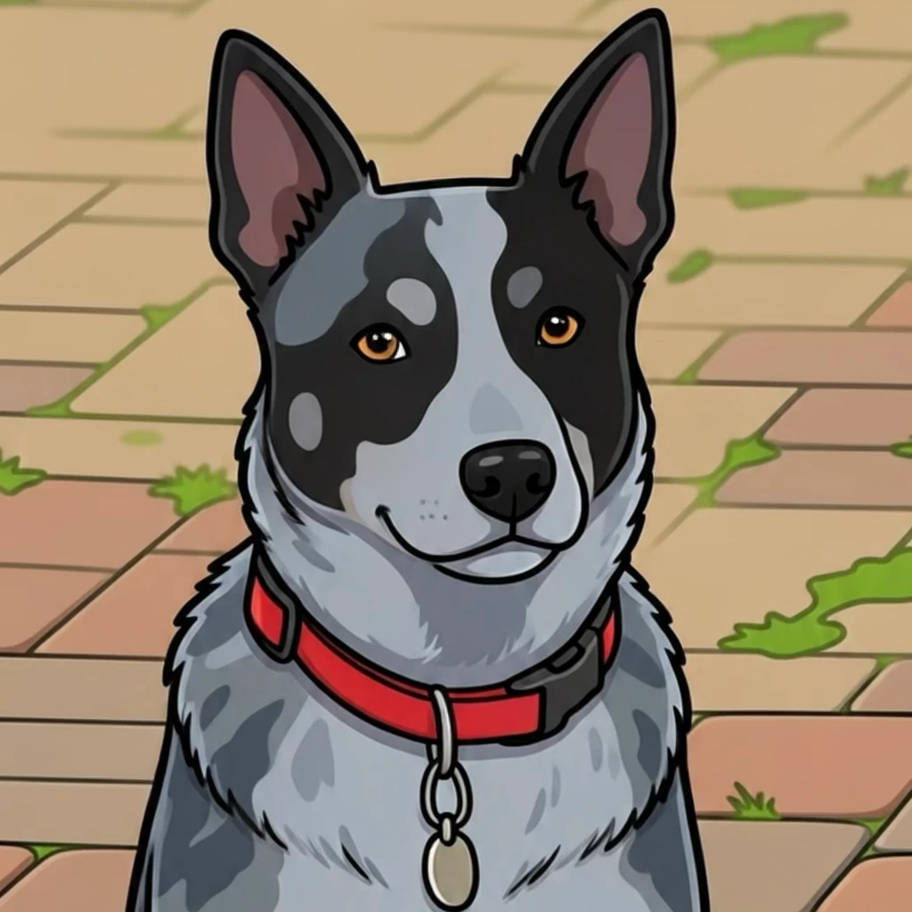
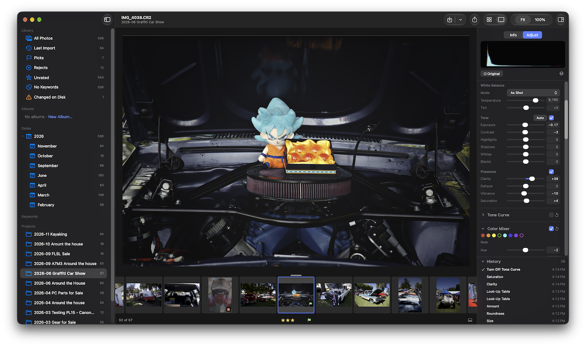

<p align="center">
  
</p>

<h1 align="center">Gus</h1>

<p align="center">
  A photo library and RAW editor for macOS, written in Swift.
</p>

<p align="center">
  <a href="docs/screenshots/gus-loupe-20261110.png"></a>
</p>

Gus catalogs photos where they already are and never changes them. Edits
are stored in the library as a list of steps and applied when a photo is
shown or exported, so the original file stays exactly as the camera wrote
it. It's a native Mac app (SwiftUI and AppKit, Core Image for rendering),
and it is still in development: there is no release yet.

I built this with Claude. AI did the work, I did the orchestration.

## What works today

**Library and culling**

- Projects, albums, smart albums, keywords and a Dates tree
- Ratings, pick/reject flags and color labels from the keyboard, plus a
  full-screen review mode
- RAW+JPEG pairs shown as one photo; culling, keywords and albums apply to both
- Keyword suggestions from Apple's Vision framework, run on the Mac
- Photos on a disconnected drive stay in the library, with their previews,
  until the drive comes back
- MOV, MP4 and M4V videos, catalogued and played alongside photos
- A film strip under the photo in the loupe, to see and click through the
  photos around it
- Compare two photos side by side in the loupe (S), with zoom and position
  linked; rate and flag the active one (A switches) to pick the better shot.
  A photo and its copy compare like any two photos; Duplicate is off while
  comparing
- Duplicate a photo to try another edit: the copy has its own edits, rating,
  keywords and albums, sits next to the original and can be removed alone
- Rename a project or an album in place, show photos or a project's folder in the
  Finder (⇧⌘R), and remove photos or a whole project from the library
  (⌘⌫ and Remove Project from Library). Removing changes the catalog only:
  your files and sidecars are never touched, and a removal can't be undone
- An About window (app menu or Help, in both apps) with the version, the
  projects Gus stands on and what each gave it, a link to each, and Gus's own
  copyright and license. The full license texts open from it once the app
  bundles carry the license files (not yet: #172)

**Import**

- An import window for cards and folders, with naming templates and
  metadata presets
- Every copy is read back and checked by hash before the source can be deleted
- Drag a folder from Finder to add it in place as a project
- A standalone importer app for copying cards without a library
- Import from an Immich server: add a server (its address and an API key),
  browse its photos in the same import window by album or capture date, pick
  some and Gus copies the original files to your folder, checks each one
  against the server's checksum and adds it to the library as an ordinary
  photo. Photos you already imported are marked and left unchecked. Importing
  the same album or All Photos again goes into the project of that name
  instead of making a second one (card and folder imports still make a new
  project each time). Gus only reads from the server: nothing on it is ever
  changed, and Immich's own edits, favorites, tags and albums aren't brought
  over (a description and a star rating are, when yours are empty). Photos
  only: no videos, and a Live Photo comes as its still. The library app only,
  not the standalone importer

**Editing**

- At 100% and above, the photo's real pixels while you drag a slider, so
  fine detail can be judged without letting go
- Crop, rotate and straighten
- White balance, exposure (with Auto), tone, clarity, vibrance and
  saturation, a tone curve, a color mixer and color grading
- Black and white with film filters: turn the group on and pick Yellow,
  Orange, Red, Green or Blue (or mix the five sliders) to say how colors turn
  into grays, as a colored filter on the lens did. It applies to the whole
  photo, not to a mask
- Sharpening, noise reduction, vignette, grain and look-up tables (`.cube`)
- A sharpening map that shows where sharpening goes and where Masking holds
  it back
- Optional machine learning noise reduction for raw files, run on the Mac
  (macOS 27 or later, for cameras Apple's raw decoder supports)
- Color fringe removal: pick a purple or green fringe from the photo, with a
  pixel magnifier showing the exact pixel and its values, or choose one from a
  short list, and it turns gray along high-contrast edges. Red/cyan and
  blue/yellow edges toward the corners are measured and corrected automatically.
- Lens distortion and lens vignetting: set them by hand on any photo, or let
  Auto read the camera's own table from the file (Fujifilm raws and DNGs
  that carry one). Auto does nothing where macOS or Fujifilm's built-in table
  already corrected the photo, so it never corrects twice. If a photo has
  spots or masks, Gus asks before a change moves them
- Masks: linear and radial gradients, a brush, and luminance and color
  ranges, combined by adding, subtracting or intersecting. Each mask
  carries its own exposure, tone, white balance, presence and sharpening.
- Subject, People and Background masks: Gus finds the subject or the people
  (up to four) in a photo on the Mac, and you adjust them or everything else
  like any other mask. The result is stored with the photo and is not
  recomputed unless you choose Update Detection. People can pick out
  something that isn't a person
- Spot healing and cloning: click a dust spot or blemish and Gus fills it
  from a clean patch nearby, chosen for you; drag the source if you want
  another, switch a spot between Heal and Clone, and set its size, feather
  and opacity. Spots stay on the same picture content when you crop or
  rotate, can be turned off to compare, and are left out of presets (Copy
  Adjustments can carry them to photos of the same size; at most 100 per
  photo; many spots slow the loupe down)
- A History panel in the loupe's inspector lists a photo's saved edits and
  keeps them across restarts; click an earlier entry to go back to it, and
  undo that if you change your mind
- RAW files from the same camera come out the same whatever you looked at
  before them: no more smeared left and right edges on some photos
- Raw files macOS can't decode (some Fujifilm X-E3 files on macOS 27.2) now
  show up and can be edited and exported. They get the same White Balance as
  any raw (the nine modes, Kelvin, Tint and Auto) and a built-in profile and
  baseline look measured against macOS's, so an unedited one comes out close
  to a raw macOS decodes. A Kelvin value can read a little differently
  between the two decoders for the same camera (Fujifilm X-T3 files read
  14% to 30% lower). For Fujifilm files Gus uses the camera's own frame and
  the lens corrections stored in the file (distortion, color fringing, corner
  shading)
- Those raws now open fast: Gus demosaics them on the GPU with its own code
  (an X-E3 file is ready at 100% in about 0.6 s, where LibRaw's own took
  about 8 s) and applies a fixed, light color noise cleanup, so there is no
  control for it. Detail is a little softer than LibRaw's on a few files, and
  a sharper version is planned (#199). If the GPU can't do it, Gus falls back
  to LibRaw and says so in the log
- Presets show as a compact list of names (the default) or as thumbnails, with
  a switch at the right of the Presets buttons; hovering a preset previews it
  on the photo in either view, and Gus remembers your choice
- Copy Adjustments (⇧⌘C) asks what to copy: a check box per heading and group
  (Crop & Straighten, Spots and the Lens groups start unchecked, the groups the
  photo has not changed are marked "No changes"), and Paste Adjustments (⇧⌘V)
  changes only what was copied, in one undo step. Masks are never copied.
  Spots paste only onto photos of the same size
- Before/after, copy and paste, and presets, including import of Lightroom
  presets (`.lrtemplate`, `.xmp`, `.dng`) and Luminar preset packs (`.lnpc`,
  several at once) with a report of anything that doesn't carry over. Luminar's
  conversion is approximate, and the report says where
- HDR display of HDR sources (floating-point DNG, gain-map HEIC and JPEG,
  HLG and PQ) on EDR screens
- Merge to HDR (⇧⌘L): select two to nine photos of one scene (all raws, or
  all JPEG, HEIC, TIFF or PNG) and Gus merges them into one new, tone-mapped
  photo, a 16-bit TIFF or a DNG, saved next to the frame you choose as the
  reference and added to the library with that frame's details. The sheet
  shows the frames; click one to make it the reference, which also decides
  what is aligned to and which frame wins where something moved. Auto-align
  and De-ghost are check boxes (on by default): a person who walked through the
  scene shows once, not as a ghost. This is the one thing Gus writes into your
  folders, always a new file with a numbered name: no original is ever opened
  for writing or replaced, and Undo takes the photo out of the library and
  leaves the file. Merging JPEGs works but is rougher than raws, because the
  camera's own tone curve isn't undone. Merges of the same frames are
  separate photos. In very dark areas of a wide bracket the reference's noise
  can still be read as movement (#257)

**Metadata and export**

- Ratings, keywords and IPTC fields are written to XMP sidecars. If another
  app has changed a sidecar, Gus shows the difference instead of overwriting it.
- Export to JPEG or 8/16-bit TIFF in sRGB, Display P3, Adobe RGB or ProPhoto
  RGB, with resizing, output sharpening, templated file names, a choice of
  metadata, an optional watermark and saved presets. Export never replaces an
  original that's in your library, even when you choose Replace: the new file
  gets a numbered name instead (`IMG_1-2.jpg`)
- ExifTool is used for metadata when it's installed, ImageIO otherwise

**Command line**

`photocli` renders photos, queries a library with smart-album rules, changes
adjustments, ratings, flags and labels, adds masks (including Subject, People
and Background), runs exports and merges brackets to HDR (`merge`, with
`--reference`, `--no-align` and `--no-deghost`). Every command
prints JSON. It can read a library at any time, but only writes to one the
app doesn't have open.

**Development**

- A test copy of the app (another bundle identifier, `swift run`, or a
  scripted launch) won't open your library unless it's given
  `--library-root <folder>`; it says why and quits

**Privacy and network**

Gus does its analysis (keyword suggestions, subject masks) on the Mac and has
no telemetry. The one thing it contacts over a network is an Immich server you
add yourself, and only that server: it sends the API key (kept in the macOS
Keychain, nowhere else) and read requests, never anything else, and it never
creates, changes or deletes anything on the server. A server must use
`https://`; plain `http://` is allowed only on your local network and only
after Gus tells you the key and photos cross the network unencrypted and you
confirm. A certificate macOS doesn't trust is never accepted silently: you see
its fingerprint and may trust that one certificate for that server, and Gus
refuses it if it changes. There is no switch to turn certificate checking off.
The About window and the standalone importer contact nothing.

## Not there yet

Removing larger objects (a remove brush) and automatic dust detection,
automatic lens corrections from other makers' tables (Sony, Panasonic,
Olympus) and lens profiles, DNG
export of your own photos (only an HDR merge can write a DNG), recovering a
camera's tone curve for JPEG merges, sky and named-object masks, DCP camera profiles, hand-made and
burst stacks, black and white for part of a photo (through a mask), mapping of Lightroom black and white settings on import,
hierarchical keywords, importing straight from a camera over USB, a second
backup destination on import, importing from servers other than Immich,
sending edited photos back to Immich (publishing is planned, #28), importing
videos or Immich's own edits. Metadata is never written into original
files; it goes to XMP sidecars.

## Requirements

- macOS 15 or later on Apple Silicon. Development and testing happen on the
  newest macOS. VoiceOver, macOS 15 and macOS 26 are largely untested by a
  person, but should work in theory.
- Xcode 26 or later to build the app (the build script checks for the
  macOS 26 SDK). `swift build` and `swift test` on their own need only a
  Swift 6 toolchain.
- Optional: [ExifTool](https://exiftool.org) on `PATH` or in `/opt/homebrew/bin`

## Building

```bash
git clone git@github.com:sesser/Gus.git
```

```bash
cd Gus
```

```bash
Scripts/build-app.sh
```

```bash
open build/*.app
```

`Scripts/build-app.sh` builds a release `.app` in `build/` and signs it ad
hoc. `Scripts/build-app.sh importer` builds the standalone importer, `all`
builds both, and `CONFIGURATION=debug` gives a debug build.

To build and run the tests without making a bundle:

```bash
swift build
```

```bash
swift test
```

`swift run photocli help` lists the command-line tool's commands. GRDB is
the only package dependency. LibRaw 0.22.3 is vendored in `Sources/CLibRaw`
under the LGPL 2.1 (see `THIRD_PARTY_NOTICES.md`) and decodes raw files the
macOS raw decoder can't.

## Documentation

- [User guide](docs/USER_GUIDE.md)
- [Roadmap](docs/roadmap.md): what's planned, what shipped and what was dropped
- [Workflow](docs/WORKFLOW.md): how a feature goes from idea to merge
- [Profiling](docs/PROFILING.md)
- Earlier design notes, from before the workflow: one per phase of work in
  [docs/archive](docs/archive), and the UI redesign in
  [docs/UI_REDESIGN.md](docs/UI_REDESIGN.md)

## Repository layout

| Path | Contents |
|---|---|
| `Sources/PhotoCore` | Catalog (GRDB), import, metadata, edits, masks and rendering, camera color (`CameraColor/`), presets, previews, sidecars, export, server connections for Immich import (`Remote/`) |
| `Sources/PhotoUI` | UI shared by both apps: the import window, the About window, grid pieces, palette, String Catalog |
| `Sources/PhotoApp` | The library app: window and toolbar, grid, loupe, inspector, sidebar, sheets |
| `Sources/PhotoImporter` | The standalone importer |
| `Sources/PhotoCLI` | `photocli` |
| `Sources/CLibRaw` | LibRaw's source, vendored and built by `Package.swift`; never edited |
| `Sources/PhotoFixtures` | Synthetic JPEG, HEIC and DNG files and a fake Immich server, for tests and benchmarks (the library app also links it, so its debug script can start the fake server) |
| `Sources/PhotoBench` | Synthetic library generator (`--brackets` makes HDR merge series), test scene files and profiling, `photobench merge` included (`photobench`) |
| `Sources/StringCatalogCompiler` | Compiles the String Catalog for the build script |
| `Sources/AppIconCompiler` | Turns `Support/AppIcon.png` into the app icon |
| `Tests/PhotoCoreTests` | Tests, golden images and CPU reference implementations |
| `Branding.xcconfig` | Product name and identifiers (see [RENAMING.md](RENAMING.md)) |

## Branches

`develop` has the latest work. `master` will hold releases.

## License

Copyright © 2026 Randy Sesser.

Gus is free software: you can redistribute it and/or modify it under the terms
of the [GNU General Public License, version 3](LICENSE) or (at your option) any
later version. It is distributed in the hope that it will be useful, but
without any warranty; see the license for details.

The vendored LibRaw is included under the GNU Lesser General Public License,
version 2.1; see `THIRD_PARTY_NOTICES.md`.

## Credits

Gus stands on other people's work, and says so:

- **LibRaw** decodes the raws macOS can't (see above).
- **darktable** showed how to apply the lens corrections Fujifilm stores in its
  raw files (distortion, lateral colour, vignetting): Gus's version was written
  in Swift and Metal after reading how darktable does it, with nothing copied,
  and is checked against the camera's own JPEG. See `THIRD_PARTY_NOTICES.md`.
- **LightCraft** for the brush and colour-range mask math (same file).
- **GRDB** for the catalog (MIT; its notice is in `THIRD_PARTY_NOTICES.md`).
- **ExifTool** reads metadata when it is installed; it is not part of Gus.
