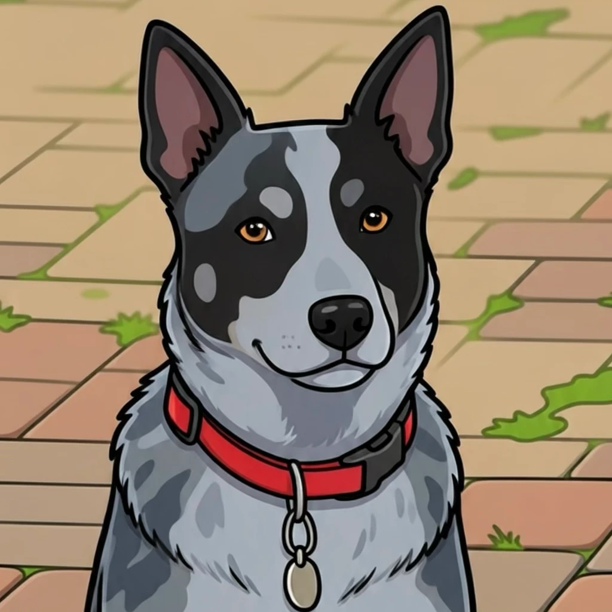
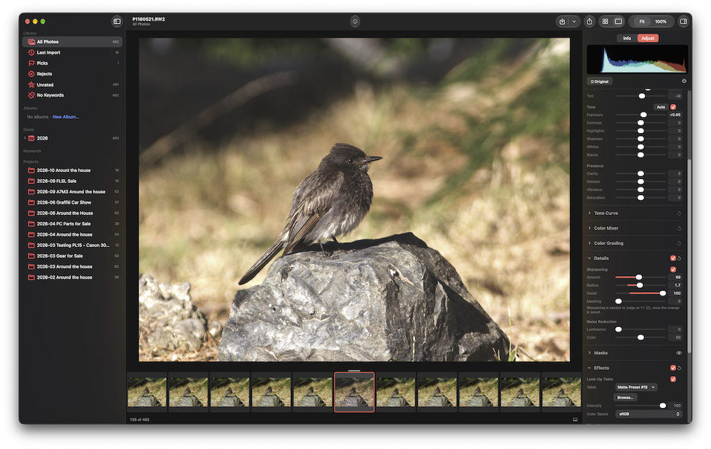

<p align="center">
  
</p>

<h1 align="center">Gus</h1>

<p align="center">
  A photo library and RAW editor for macOS, written in Swift.
</p>

<p align="center">
  <a href="docs/screenshots/gus-loupe-20261104.png"></a>
</p>

Gus catalogs photos where they already are and never changes them. Edits
are stored in the library as a list of steps and applied when a photo is
shown or exported, so the original file stays exactly as the camera wrote
it. It's a native Mac app (SwiftUI and AppKit, Core Image for rendering),
and it is still in development: there is no release yet.

I built this with Claude. AI did the work, I did the orchestration.

## What works today

**Library and culling**

- Projects, albums, smart albums, keywords and a Dates tree
- Ratings, pick/reject flags and color labels from the keyboard, plus a
  full-screen review mode
- RAW+JPEG pairs shown as one photo; culling, keywords and albums apply to both
- Keyword suggestions from Apple's Vision framework, run on the Mac
- Photos on a disconnected drive stay in the library, with their previews,
  until the drive comes back
- MOV, MP4 and M4V videos, catalogued and played alongside photos

**Import**

- An import window for cards and folders, with naming templates and
  metadata presets
- Every copy is read back and checked by hash before the source can be deleted
- Drag a folder from Finder to add it in place as a project
- A standalone importer app for copying cards without a library

**Editing**

- Crop, rotate and straighten
- White balance, exposure (with Auto), tone, clarity, vibrance and
  saturation, a tone curve, a color mixer and color grading
- Sharpening, noise reduction, vignette, grain and look-up tables (`.cube`)
- Masks: linear and radial gradients, a brush, and luminance and color
  ranges, combined by adding, subtracting or intersecting. Each mask
  carries its own exposure, tone, white balance, presence and sharpening.
- Before/after, copy and paste, and presets, including import of Lightroom
  presets (`.lrtemplate`, `.xmp`, `.dng`) with a report of anything that
  doesn't carry over
- HDR display of HDR sources (floating-point DNG, gain-map HEIC and JPEG,
  HLG and PQ) on EDR screens

**Metadata and export**

- Ratings, keywords and IPTC fields are written to XMP sidecars. If another
  app has changed a sidecar, Gus shows the difference instead of overwriting it.
- Export to JPEG or 8/16-bit TIFF in sRGB, Display P3, Adobe RGB or ProPhoto
  RGB, with resizing, output sharpening, templated file names, a choice of
  metadata, an optional watermark and saved presets
- ExifTool is used for metadata when it's installed, ImageIO otherwise

**Command line**

`photocli` renders photos, queries a library with smart-album rules, changes
adjustments, ratings, flags and labels, and runs exports. Every command
prints JSON. It can read a library at any time, but only writes to one the
app doesn't have open.

## Not there yet

Healing, lens corrections, DNG export, ML noise reduction and automatic
(subject/sky) masks, DCP camera profiles, hand-made and burst stacks,
hierarchical keywords, importing straight from a camera over USB, a second
backup destination on import. Metadata is never written into original
files; it goes to XMP sidecars.

## Requirements

- macOS 15 or later on Apple Silicon
- Xcode 26 or later to build the app (the build script checks for the
  macOS 26 SDK). `swift build` and `swift test` on their own need only a
  Swift 6 toolchain.
- Optional: [ExifTool](https://exiftool.org) on `PATH` or in `/opt/homebrew/bin`

## Building

```bash
git clone git@github.com:sesser/Gus.git
```

```bash
cd Gus
```

```bash
Scripts/build-app.sh
```

```bash
open build/*.app
```

`Scripts/build-app.sh` builds a release `.app` in `build/` and signs it ad
hoc. `Scripts/build-app.sh importer` builds the standalone importer, `all`
builds both, and `CONFIGURATION=debug` gives a debug build.

To build and run the tests without making a bundle:

```bash
swift build
```

```bash
swift test
```

`swift run photocli help` lists the command-line tool's commands. GRDB is
the only third-party dependency.

## Documentation

- [User guide](docs/USER_GUIDE.md)
- Design notes for each phase of work: [docs](docs)
- [Profiling](docs/PROFILING.md)

## Repository layout

| Path | Contents |
|---|---|
| `Sources/PhotoCore` | Catalog (GRDB), import, metadata, edits, masks and rendering, presets, previews, sidecars, export |
| `Sources/PhotoUI` | UI shared by both apps: the import window, grid pieces, palette, String Catalog |
| `Sources/PhotoApp` | The library app: window and toolbar, grid, loupe, inspector, sidebar, sheets |
| `Sources/PhotoImporter` | The standalone importer |
| `Sources/PhotoCLI` | `photocli` |
| `Sources/PhotoFixtures` | Synthetic JPEG, HEIC and DNG files for tests and benchmarks |
| `Sources/PhotoBench` | Synthetic library generator and profiling (`photobench`) |
| `Sources/StringCatalogCompiler` | Compiles the String Catalog for the build script |
| `Sources/AppIconCompiler` | Turns `Support/AppIcon.png` into the app icon |
| `Tests/PhotoCoreTests` | Tests, golden images and CPU reference implementations |
| `Branding.xcconfig` | Product name and identifiers (see [RENAMING.md](RENAMING.md)) |

## Branches

`develop` has the latest work. `master` will hold releases.

## License

Copyright © 2026 Randy Sesser.

Gus is free software: you can redistribute it and/or modify it under the terms
of the [GNU General Public License, version 3](LICENSE) or (at your option) any
later version. It is distributed in the hope that it will be useful, but
without any warranty; see the license for details.
